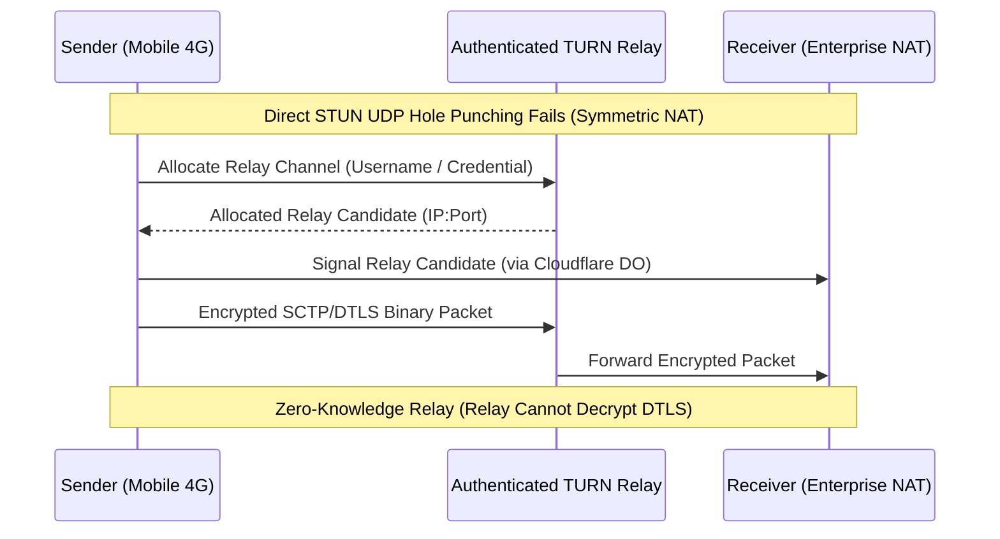

# GhostShare — Privacy-First WebRTC Peer-to-Peer File Transfer

GhostShare is an open-source, anonymous, browser-based, direct peer-to-peer (P2P) file-transfer application built for the modern web.

Files travel directly browser-to-browser across encrypted WebRTC data channels (**SCTP over DTLS**). **Zero cloud file-storage buckets (no R2, B2, or S3), zero server-side file retention, zero user accounts, and zero credit cards or billing credentials are required.**

The central server functions solely as an ephemeral signaling coordinator. Once two browsers establish a direct WebRTC connection, all file transfers, chunk streaming, flow control backpressure, and interactive chat messages execute directly between the peers.

---

## 📑 Table of Contents

1. [Overview & Vision](#1-overview--vision)
2. [Core Features](#2-core-features)
3. [System Architecture](#3-system-architecture)
4. [Peer-to-Peer Transfer Workflow](#4-peer-to-peer-transfer-workflow)
5. [Storage Hierarchy & Quotas](#5-storage-hierarchy--quotas)
6. [Prerequisites & Browser Compatibility](#6-prerequisites--browser-compatibility)
7. [Installation & Local Development](#7-installation--local-development)
8. [Configuration & Environment Variables](#8-configuration--environment-variables)
9. [TURN Connectivity & Relay Configuration](#9-turn-connectivity--relay-configuration)
10. [Security & Privacy Model (Controls 1–32)](#10-security--privacy-model)
11. [Testing & Quality Assurance](#11-testing--quality-assurance)
12. [CI/CD & Dependency Health](#12-cicd--dependency-health)
13. [Production Deployment](#13-production-deployment)
14. [Troubleshooting & Operational Guide](#14-troubleshooting--operational-guide)
15. [Repository Structure & Contributing](#15-repository-structure--contributing)

---

## 1. Overview & Vision

Traditional file transfer services upload your files to third-party cloud buckets (such as Amazon S3, Google Drive, or WeTransfer), store them on centralized disks, and send recipients a download link. This model exposes sensitive data to storage leaks, cloud outages, bandwidth bills, and surveillance.

**GhostShare operates on a fundamentally different paradigm:**
- **Zero Cloud File Storage**: Neither the Cloudflare Worker nor any external bucket ever sees, buffers, or stores your file payloads.
- **Direct SCTP over DTLS**: Files are sliced and streamed directly from the sender's disk to the receiver's disk using native WebRTC data channels protected by DTLS encryption.
- **Ephemeral Coordination**: The Cloudflare Worker only relays small ephemeral signaling messages (SDP offers/answers, ICE candidates) stored temporarily in SQLite-backed Durable Objects.
- **Zero Accounts & Tracking**: No passwords, cookies, tracking telemetry, or accounts. A cryptographically random 8-digit PIN or QR code pairs two browsers within seconds.

---

## 2. Core Features

- **Three Dedicated Operating Modes**:
  - **Receive Mode**: Generates an 8-digit PIN and dynamic QR code, waits for connection, inspects manifests, selects download locations, and approves incoming batches.
  - **Send Mode**: Connects via PIN/QR, stages single or multiple files, and streams data upon receiver approval.
  - **Dual Mode**: Unlocks bidirectional simultaneous transfers and real-time live chat over dedicated directional channels without reconnection.
- **CSPRNG 8-Digit Pairing & QR Code**:
  - Generated via Web Crypto CSPRNG with rejection sampling to eliminate modulo bias.
  - Built-in camera scanner powered by `html5-qrcode` with automatic camera switching (environment vs. user facing).
- **Advanced Three-Tier Storage Engine**:
  - **Tier 1 (OPFS Streaming)**: Direct-to-disk streaming via Origin Private File System (`FileSystemWritableFileStream`). Supports multi-gigabyte transfers with flat ~15 MB memory footprint.
  - **Tier 2 (File System Access API)**: Per-file destination picker (`showSaveFilePicker`) allowing users to stream files directly into arbitrary local folders.
  - **Tier 3 (RAM Buffer Fallback)**: Strictly capped at 100 MB to safely support browsers lacking OPFS without causing tab memory crashes.
- **Reliable Binary Chunk Framing**:
  - High-performance binary packet framing (`0x5348` magic bytes) with monotonic chunk sequencing, 32-bit chunk offsets, and 64-bit total length validation.
- **Backpressure & Memory Throttling**:
  - `bufferedAmountLowThreshold` (256 KB) throttling prevents browser buffer overflows and tab unresponsiveness.
- **Ephemeral Live Chat**:
  - Low-latency chat messaging transmitted over dedicated WebRTC data channel with timestamping, role indicators, and strict 1,000-character input limits.
- **Connection Diagnostics & NAT Auditing**:
  - Real-time candidate pair inspection identifying whether peers connected via direct local host, reflexive STUN, or relayed TURN.
  - Accurate TURN warning diagnostics when symmetric NAT is detected without active TURN credentials.

---

## 3. System Architecture

### Architectural Data Flow

```mermaid
flowchart TD
    subgraph Signaling Phase (Ephemeral Coordination)
        Sender["Sender Browser"]
        Receiver["Receiver Browser"]
        Worker["Cloudflare Worker (OpenNext)"]
        DO["SignalingSessionDO (SQLite Durable Object)"]

        Receiver -->|"1. POST /api/signal/session (Create PIN)"| Worker
        Worker -->|"Route to PIN DO"| DO
        Sender -->|"2. POST /api/signal/session/:code (Join)"| Worker
        Sender <-->|"3. Exchange SDP Offer / Answer & ICE Candidates"| DO
        Receiver <-->|"3. Poll /api/signal/poll (Monotonic Cursor)"| DO
    end

    subgraph Direct P2P Data Path (WebRTC)
        Sender <===|"4. SCTP DataChannel: 'file-transfer-send' (Direct Binary Chunks)"|===> Receiver
        Sender <===|"5. SCTP DataChannel: 'file-transfer-recv' (Dual Reverse Chunks)"|===> Receiver
        Sender <===|"6. SCTP DataChannel: 'control' (Manifest, Ready, Ack)"|===> Receiver
        Sender <===|"7. SCTP DataChannel: 'chat' (Ephemeral Messaging)"|===> Receiver
    end

    subgraph Fallback Relay (Symmetric NAT Only)
        Sender -.->|"Relayed SCTP over DTLS (RFC 8656)"| TURN["Authenticated TURN Relay"]
        TURN -.->|"Relayed SCTP over DTLS"| Receiver
    end
```

### Protocol & Security Specifications

| Layer | Protocol | Specification | Details |
| :--- | :--- | :--- | :--- |
| **Signaling** | HTTPS / JSON | REST / Polling | Bounded request reader (8 KB / 64 KB), rate-limited per IP, monotonic sequence cursor |
| **P2P Transport** | WebRTC Data Channels | RFC 8831 / RFC 8261 | **SCTP over DTLS** (not DTLS/SRTP; DTLS/SRTP is for media RTP only) |
| **Data Framing** | Custom Binary Framing | Big-Endian Header | `0x5348` magic bytes + 36-byte file UUID + 4-byte index + 8-byte offset + payload |
| **State Storage** | Cloudflare Durable Objects | SQLite Storage | Authoritative isolate per session, atomic SQL operations, zero cross-region replication delay |

---

## 4. Peer-to-Peer Transfer Workflow

1. **Session Initialization**:
   - Receiver visits GhostShare and selects **Receive** or **Dual** mode.
   - Browser calls `POST /api/signal/session` requesting an 8-digit session PIN with a selected TTL (e.g., 10 minutes).
   - Server returns the pairing code and an unguessable 192-bit CSPRNG `receiverToken`.
2. **Peer Discovery & Handshake**:
   - Sender enters the 8-digit PIN or scans the QR code via `POST /api/signal/session/:code`.
   - Receiver generates a WebRTC SDP Offer; Sender receives the offer and responds with an SDP Answer.
   - Trickle ICE candidates are exchanged via `/api/signal/message` and fetched using cursor-based polling via `/api/signal/poll`.
3. **Data Channel Negotiation**:
   - WebRTC connection opens 4 dedicated bidirectional channels:
     - `control`: Manifest negotiation, transfer authorization, `file-ready`, `file-ack`, and error signaling.
     - `file-transfer-send`: Primary binary streaming channel from Sender to Receiver.
     - `file-transfer-recv`: Secondary binary channel for reverse transfers in Dual Mode.
     - `chat`: Real-time ephemeral text messaging.
4. **Manifest Staging & Receiver Authorization**:
   - Sender stages files (via file picker, folder drag-and-drop, or clipboard paste).
   - Sender transmits a JSON `transfer-request` batch manifest over the `control` channel containing file names, sanitized MIME types, exact byte lengths, and unique protocol UUIDs.
   - Receiver displays an interactive approval modal. Transfer begins **only after explicit receiver approval**.
5. **Streaming & Backpressure**:
   - Receiver allocates a disk sink (OPFS or user-selected `FileSystemFileHandle`) and sends a `file-ready` signal.
   - Sender slices the file into 32 KB binary chunks and frames each with the `0x5348` header.
   - Sender monitors `channel.bufferedAmount`. If buffered bytes exceed 256 KB, transmission yields until `onbufferedamountlow` triggers.
6. **Integrity Verification & Acknowledgement**:
   - Receiver's `ByteRangeTracker` tracks contiguous received byte intervals.
   - Upon receiving `file-end`, the receiver verifies total byte count and flushes the disk stream.
   - Receiver sends `file-ack` over the `control` channel. Sender marks file complete.

---

## 5. Storage Hierarchy & Quotas

```
┌─────────────────────────────────────────────────────────────────┐
│                    Incoming File Transfer                       │
└────────────────────────────────┬────────────────────────────────┘
                                 │
                 Is OPFS supported by browser?
                                 │
            ┌────────────────────┴────────────────────┐
           YES                                        NO
            │                                         │
 ┌──────────────────────┐                  ┌──────────────────────┐
 │ Tier 1: OPFS Storage │                  │ Tier 3: RAM Buffer   │
 │ Direct-to-Disk Stream│                  │ In-Memory Uint8Array │
 │ File size: Unlimited │                  │ Max limit: 100 MB    │
 │ (Disk quota bounded) │                  │ (>100MB fails safely)│
 └──────────┬───────────┘                  └──────────────────────┘
            │
  Did user choose custom destination?
            │
 ┌──────────┴───────────┐
YES                     NO
 │                      │
┌─────────────────────┐┌──────────────────────────────────────────┐
│ Tier 2: FSA API     ││ Default: OPFS Sandboxed Storage          │
│ FileSystemFileHandle││ Saved under /ghostshare-temp/{fileId}.bin│
│ Streamed to folder  ││ Download triggered via Blob Object URL   │
└─────────────────────┘└──────────────────────────────────────────┘
```

### Storage Tiers Explained

1. **Tier 1: Native OPFS (Origin Private File System)**:
   - Uses `navigator.storage.getDirectory()` and `createWritable()`.
   - File data streams directly to local disk without accumulating in browser RAM.
   - Supports arbitrary file sizes up to the browser's disk quota (typically 60–80% of free storage).
2. **Tier 2: User-Selected Destination (File System Access API)**:
   - On browsers supporting `showSaveFilePicker` (Chrome, Edge, Opera), users can click **"Save to..."** to pick an exact destination folder before accepting.
   - The stream writes directly to the user's selected file without an intermediate temporary file.
3. **Tier 3: Bounded In-Memory RAM Fallback**:
   - Triggered when OPFS is unavailable (e.g., non-secure HTTP contexts or legacy browsers).
   - Strictly bounded to **100 MB** per file. If an incoming file exceeds 100 MB, the transfer is rejected immediately with an explicit warning to protect against tab crash.
4. **Automatic Ephemeral Storage Cleanup**:
   - On session end, transfer cancellation, peer disconnect, or session reset, `cleanupSessionStorage()` unlinks all temporary OPFS files (`/ghostshare-temp/*`).

---

## 6. Prerequisites & Browser Compatibility

### Prerequisites
- **Node.js**: `20.x` or later (tested on Node 20, 22).
- **Package Manager**: `npm` (v10+).

### Browser Compatibility Matrix

| Browser | Platform | WebRTC P2P | OPFS Streaming (>100 MB) | File System Picker ("Save to...") | Mobile Camera QR |
| :--- | :--- | :---: | :---: | :---: | :---: |
| **Google Chrome** | Desktop (Win/Mac/Linux) | Full | Full | Full | N/A |
| **Microsoft Edge** | Desktop (Win/Mac/Linux) | Full | Full | Full | N/A |
| **Mozilla Firefox** | Desktop (Win/Mac/Linux) | Full | Full | Fallback to OPFS Blob | N/A |
| **Apple Safari** | Desktop (macOS 15.2+) | Full | Full | Fallback to OPFS Blob | N/A |
| **Chrome for Android** | Mobile (Android 10+) | Full | Full | Fallback to OPFS Blob | Full |
| **Safari for iOS** | Mobile (iOS 17+) | Full | Full | Fallback to OPFS Blob | Full |

---

## 7. Installation & Local Development

### 1. Clone Repository
```bash
git clone https://github.com/shshmichael020-alt/ghostshare.git
cd ghostshare
```

### 2. Install Dependencies
```bash
npm ci
```

### 3. Configure Local Environment
Copy the example environment configuration:
```bash
cp .env.local.example .env.local
```

### 4. Run Development Server
```bash
npm run dev
```
Open [http://localhost:3000](http://localhost:3000) in your browser.

### 5. Run Verification Battery
```bash
# Type check TypeScript
npx tsc --noEmit

# Run ESLint
npm run lint

# Run all 99 automated tests
npm test

# Build Cloudflare Worker bundle
npm run cf:build
```

---

## 8. Configuration & Environment Variables

| Variable | Scope | Type | Default | Purpose |
| :--- | :--- | :--- | :--- | :--- |
| `SIGNALING_DO` | Cloudflare Binding | Durable Object | Binding | Authoritative SQLite session coordinator binding |
| `TURN_SERVERS_JSON` | Cloudflare Secret / Env | JSON String | None | Static authenticated TURN server array `[{"urls":"turn:...","username":"...","credential":"..."}]` |
| `CF_REALTIME_TURN_TOKEN` | Cloudflare Secret / Env | String | None | Cloudflare Calls / Realtime dynamic TURN credentials token |
| `CF_ACCOUNT_ID` | Cloudflare Secret / Env | String | None | Cloudflare Account ID for Calls Realtime TURN API |
| `CF_API_TOKEN` | Cloudflare Secret / Env | String | None | Cloudflare API token with Calls:Edit permissions |
| `METERED_API_KEY` | Cloudflare Secret / Env | String | None | Metered.ca dynamic TURN credential API key |
| `ALLOWED_ORIGINS` | Env Variable | Comma-delimited | Domain / Localhost | Trusted origin whitelist for CORS and CSRF validation |

---

## 9. TURN Connectivity & Relay Configuration

### The Symmetric NAT Challenge
Direct peer-to-peer WebRTC connections rely on **STUN (Session Traversal Utilities for NAT)** to perform UDP hole punching. While STUN succeeds across most residential routers and full-cone NATs (~85% of connections), it **fails** when one or both peers are behind:
- **Symmetric NAT** (common on cellular/mobile carriers, 4G/5G mobile hotspots, and CGNAT).
- **Enterprise and University Firewalls** blocking outbound UDP or random ports.

In such environments, peers cannot establish direct transport connectivity and require a **TURN (Traversal Using Relays around NAT)** server.

### TURN Relay Architecture & Zero Knowledge
- **RFC 5766 / RFC 8656 Compliance**: TURN acts as an encrypted transport packet relay.
- **Zero Decryption**: Because the data channel is protected by **SCTP over DTLS**, the TURN relay receives only ciphertext UDP datagrams. The TURN provider cannot inspect, decrypt, or tamper with file contents.
- **Zero Persistent Storage**: TURN servers forward packets in memory and do not buffer or save files.



### Supported Providers & Transparent Costs

GhostShare supports dynamic credentials from three TURN backends:
1. **Metered.ca TURN**:
   - Free tier includes **50 GB / month** of relayed bandwidth.
   - Set secret: `npx wrangler secret put METERED_API_KEY`.
2. **Cloudflare Calls Realtime TURN**:
   - Enterprise-grade global anycast relay.
   - Set secrets: `CF_REALTIME_TURN_TOKEN`, `CF_ACCOUNT_ID`, `CF_API_TOKEN`.
3. **Custom Coturn / Self-Hosted RFC 5766 Server**:
   - Static credentials configured via `TURN_SERVERS_JSON`.

> [!NOTE]
> If no TURN credentials are configured, GhostShare falls back to public Google and Cloudflare STUN servers. Direct transfers will function between residential networks, but mobile-to-mobile transfers behind symmetric NATs will report a clear diagnostic warning.

---

## 10. Security & Privacy Model

GhostShare implements an exhaustive 32-control security matrix:

| Control | Implementation & Verification |
| :--- | :--- |
| **Control 1: Constant-Time Token Verification** | Cryptographic tokens are validated using `crypto.timingSafeEqual` in `lib/SignalingSessionDO.ts` to eliminate timing side-channels. |
| **Control 2: CSPRNG Pairing PINs** | Uniform rejection sampling eliminates modulo bias in 8-digit PIN generation. |
| **Control 3: Cross-Session IDOR Isolation** | Sessions are isolated inside separate Durable Object instances; role-spoofing is blocked at the isolate level. |
| **Control 4: Trusted IP Extraction** | Extracts client IPs strictly from trusted `CF-Connecting-IP` headers to prevent spoofed X-Forwarded-For headers. |
| **Control 5: Metadata Sanitization** | `sanitizeFileName` strips directory traversal (`../`), null bytes, control characters, and reserved Windows/POSIX names. |
| **Control 6: Explicit Receiver Authorization** | No binary file bytes are transmitted before receiver issues explicit user approval on the control channel. |
| **Control 7: CORS & Origin Validation** | Mutating endpoints reject unauthorized cross-origin requests; non-whitelisted origins receive HTTP 403. |
| **Control 8: Monotonic Signaling Sequences** | Durable Object enforces strictly monotonic sequence increments to eliminate out-of-order signaling replay. |
| **Control 9: Capability Token for TTL / Delete** | Session termination and TTL extension require an unexposed 192-bit `receiverToken`. |
| **Control 10: Automatic Ephemeral Cleanup** | Durable Objects enforce TTL expiration (10 min default) and purge expired session records. |
| **Control 11: Rate Limiting across Isolates** | Sliding-window per-IP rate limiting enforced in SQLite storage across all Cloudflare isolates. |
| **Control 12: Memory Safety Backpressure** | Sender monitors `bufferedAmount` (256 KB ceiling) to prevent tab crash and memory bloat. |
| **Control 13: Bounded RAM Fallback Ceiling** | 100 MB strict ceiling on in-memory buffers when OPFS is unavailable. |
| **Control 14: Collision-Proof OPFS Sinks** | Incoming files are isolated under unique protocol UUID keys (`${fileId}.bin`) to prevent local overwrites. |
| **Control 15: Content Security Policy & Security Headers** | Strict CSP: `frame-ancestors 'none'`, `object-src 'none'`, HSTS, `X-Content-Type-Options: nosniff`. |
| **Control 16: Binary Packet Magic Headers** | Binary packets require `0x5348` magic bytes; non-protocol packets are discarded immediately. |
| **Control 17: Multi-File Batch Correlation** | Each file transfer is correlated with an authoritative `batchId`; rogue packets from prior batches are rejected. |
| **Control 18: Anti-CSRF Protection** | Browser state mutations enforce origin matching and content-type constraints. |
| **Control 19: Strict MIME Type Sanitization** | MIME types are restricted to RFC 2045 compliant tokens; invalid types default to `application/octet-stream`. |
| **Control 20: Storage Quota Pre-Flight Check** | Checks `navigator.storage.estimate()` before accepting batches to prevent disk exhaustion. |
| **Control 21: Clean Destination Allocation** | User-selected file handles are allocated per-file; failed file sinks fail explicitly without RAM fallback. |
| **Control 22: ICE Candidate Sanitization** | Strips dangerous port 53 (DNS rebinding) candidates and rejects unauthenticated TURN relays. |
| **Control 23: Threat Model Integrity** | Signaling server is untrusted; file payloads never touch server memory or persistent disks. |
| **Control 24: Secure CI/CD & Supply Chain** | GitHub Actions enforces `contents: read` permissions, dependency secret scanning, and automated audits. |
| **Control 25: Incremental Bounded Request Reader** | `readBoundedJson` reads request bodies incrementally, aborting early with HTTP 413 if limits (8 KB / 64 KB) are exceeded. |
| **Control 26: Replay Resistance & Protocol Idempotency** | Protocol transfer IDs are distinct UUIDs; completed files ignore redundant replay frames. |
| **Control 27: WebRTC Transport Privacy** | Peer-to-peer data channels use SCTP over DTLS; TURN relay cannot decrypt DTLS payloads. |
| **Control 28: Malicious Metadata Defense** | File sizes must be integers between 0 and `MAX_SAFE_INTEGER`; NaN, negative sizes, and prototype pollution are blocked. |
| **Control 29: Temporary File Cleanup** | Local OPFS directories are purged upon session completion, reset, or disconnection. |
| **Control 30: Complete API Authorization Audit** | All API route handlers enforce strict method filtering, input validation, and role authentication. |
| **Control 31: Information Disclosure Prevention** | Internal exception messages and stack traces are suppressed; clients receive generic errors with correlated `errorId`. |
| **Control 32: Automated Regression Testing** | 99 automated tests verify security controls, edge cases, quota bounds, and lifecycle events. |

---

## 11. Testing & Quality Assurance

GhostShare maintains a 100% automated test suite with **99 passing tests** covering 7 core functional groups:

```bash
npm test
```

### Test Coverage Groups

- **Group A: Ephemeral Pairing & Cryptography (10 tests)**:
  - Cryptographic randomness, CSPRNG rejection sampling, uniform 8-digit PIN generation, and sliding-window rate limiting.
- **Group B: Durable Object Session & Authorization (13 tests)**:
  - SQLite persistence, monotonic signaling sequences, cursor polling, role spoofing defense, capability token validation, and TTL cleanup.
- **Group C: WebRTC Protocol & Framing (11 tests)**:
  - Binary framing (`0x5348`), corrupted frame rejection, data channel lifecycle, backpressure thresholds, and candidate sanitization.
- **Group D: Storage Engine & Quotas (26 tests)**:
  - OPFS streaming >100 MB, `ByteRangeTracker` contiguous coalescing, duplicate/out-of-order chunk safety, 100 MB RAM fallback ceiling, and quota failure aborts.
- **Group E: Multi-File Transfers & Destinations (12 tests)**:
  - Batch correlation, sequential batching, receiver decline recovery, per-file destination handles, and terminal write failures.
- **Group F: ICE & TURN Diagnostics (7 tests)**:
  - STUN vs. authenticated TURN parsing, port 53 filtering, ICE route caching with accurate `turnConfigured` metadata, and connection diagnostics.
- **Group G: Security Hardening (Controls 1–32) (20 tests)**:
  - Incremental body limits (HTTP 413), error masking (`errorId` correlation without stack leakage), timing attack resistance, and CSP headers.

---

## 12. CI/CD & Dependency Health

The repository utilizes GitHub Actions (`.github/workflows/ci.yml`) to enforce automated quality gates on every commit and pull request:
- **Least-Privilege Token Permissions**: Strict `permissions: contents: read` configuration.
- **Automated Verification**: Runs `npm ci`, `npx tsc --noEmit`, `npm run lint`, `npm test`, `npm run cf:build`, and `npm audit`.
- **Secret Scanning Guard**: Scans repository commits for accidental credential leaks.
- **Zero-Vulnerability Baseline**: Pinned dependencies adhere to strict security policies (`npm audit: found 0 vulnerabilities`).

---

## 13. Production Deployment

GhostShare is deployed globally on **Cloudflare Workers** using **OpenNext Cloudflare**:

- **Production URL**: [https://ghostshare.shshmichael020.workers.dev](https://ghostshare.shshmichael020.workers.dev)
- **Runtime Architecture**:
  - Next.js 16 app compiled to Edge Worker bundle (`.open-next/worker.js`).
  - Durable Objects with SQLite backend handle signaling sessions.
  - Static frontend assets served directly from Cloudflare's edge cache.

### Deploying to Cloudflare Workers

1. Authenticate with Wrangler:
   ```bash
   npx wrangler login
   ```
2. Build and Deploy:
   ```bash
   npm run deploy
   ```

---

## 14. Troubleshooting & Operational Guide

| Issue | Root Cause | Solution |
| :--- | :--- | :--- |
| **"Connection failed / ICE Disconnected"** | Both peers behind symmetric NAT or corporate firewall blocking UDP. | Configure TURN credentials via `TURN_SERVERS_JSON`, `METERED_API_KEY`, or `CF_REALTIME_TURN_TOKEN`. |
| **"Transfer exceeds 100 MB in-memory limit"** | Browser does not support OPFS or running in an insecure HTTP context. | Use a modern browser (Chrome, Edge, Firefox, Safari) over HTTPS (`localhost` is allowed for local dev). |
| **"Storage Quota Exceeded / Disk Full"** | Receiving device does not have sufficient free disk space. | Free up disk space on the receiver device. OPFS quota is bounded by available disk storage. |
| **"Session expired or not found"** | Pairing PIN exceeded its configured TTL window (default 10 min). | Receiver must generate a fresh pairing PIN; sender must enter the new code. |
| **"Untrusted cross-origin request"** | Client request originated from an origin not present in whitelist. | Add your custom domain to `ALLOWED_ORIGINS` in environment variables. |
| **"Camera failed to start in QR Scanner"** | Camera permission denied or device lacks camera hardware. | Grant browser camera permissions or type the 8-digit PIN manually. |

---

## 15. Repository Structure & Contributing

```
ghostshare/
├── app/                                 # Next.js App Router
│   ├── api/signal/                      # Ephemeral signaling endpoints
│   │   ├── ice-servers/route.ts         # Cached ICE/TURN server discovery
│   │   ├── message/route.ts             # Signal message submission
│   │   ├── poll/route.ts                # Monotonic cursor-based signal polling
│   │   ├── session/route.ts             # Session creation
│   │   └── session/[code]/route.ts      # Session join & management
│   ├── globals.css                      # Tailwind CSS v4 styling & design system
│   ├── layout.tsx                       # Root layout, metadata & security headers
│   └── page.tsx                         # Main client interface (Send / Receive / Dual)
├── components/                          # React UI components
│   ├── DualPanel.tsx                    # Bidirectional simultaneous transfer panel
│   ├── EphemeralChat.tsx                # Real-time WebRTC live chat interface
│   ├── FileTypeIcon.tsx                 # Dynamic file type iconography
│   ├── Header.tsx                       # Application header, ghost branding & telemetry
│   ├── PinDisplay.tsx                   # 8-digit PIN & QR code renderer
│   ├── PinInput.tsx                     # 8-digit PIN input with auto-advance
│   ├── QrScannerModal.tsx               # HTML5 QR code camera scanner
│   ├── ReceivePanel.tsx                 # Receiver staging, manifest & download UI
│   ├── SecurityModal.tsx                # Interactive Controls 1–32 audit modal
│   ├── SendPanel.tsx                    # File staging, drag-and-drop & progress UI
│   └── ToastStack.tsx                   # Accessible toast notifications
├── context/
│   └── SessionContext.tsx               # Primary WebRTC & transfer state machine
├── lib/                                 # Core libraries & utilities
│   ├── codes.ts                         # CSPRNG 8-digit code generator
│   ├── constants.ts                     # Protocol limits, chunk sizes, backpressure
│   ├── crypto.ts                        # Web Crypto CSPRNG & timingSafeEqual
│   ├── format.ts                        # Byte formatting & timer formatters
│   ├── iceConfig.ts                     # ICE/TURN sanitization & caching
│   ├── opfs.ts                          # OPFS & File System Access API streaming engine
│   ├── rateLimit.ts                     # Sliding-window IP rate limiter
│   ├── requestBody.ts                   # Bounded streaming request reader & error masking
│   ├── SignalingSessionDO.ts            # Authoritative SQLite Durable Object
│   ├── signalStore.ts                   # Signaling interface contract
│   ├── useToasts.ts                     # Toast state management hook
│   └── webrtc.ts                        # WebRTC peer connection & framing logic
├── public/                              # Static icons, manifest, favicon
├── tests/                               # 99 automated unit & integration tests
├── worker.ts                            # Cloudflare Worker entry point
├── wrangler.jsonc                       # Wrangler configuration & DO bindings
├── open-next.config.ts                  # OpenNext Cloudflare configuration
└── next.config.ts                       # Next.js configuration & security headers
```

### Contributing

Contributions are welcome! Please adhere to these guidelines:
1. Fork the repository and create a descriptive feature branch.
2. Ensure all 99 automated tests pass: `npm test`.
3. Ensure static typing and linting pass: `npx tsc --noEmit && npm run lint`.
4. Ensure the Cloudflare bundle builds cleanly: `npm run cf:build`.
5. Submit a pull request with clear description and evidence.

---

## 📄 License

GhostShare is open source software licensed under the **MIT License**.
